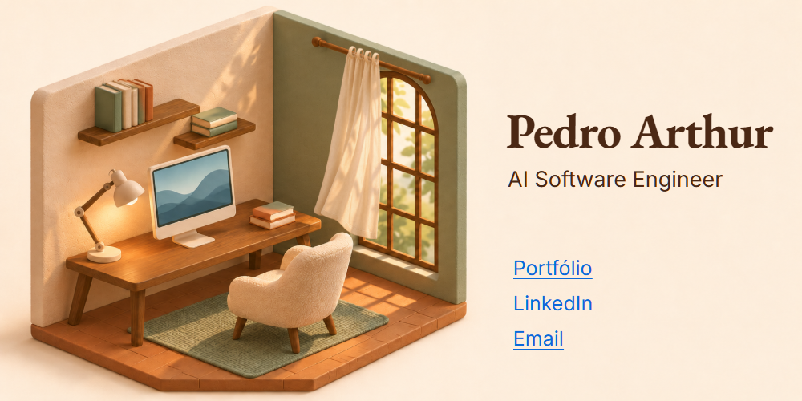

# Versões do perfil

Três cenários animados para comparar. Abra uma versão para ver o README completo.

<table>
  <tr>
    <td width="33%" align="center"><a href="espaco/README.md"> <strong>Janela orbital</strong></a></td>
    <td width="33%" align="center"><a href="estudio/README.md"> <strong>Pequeno estúdio</strong></a></td>
    <td width="33%" align="center"><a href="cidade/README.md"> <strong>Cidade ao entardecer</strong></a></td>
  </tr>
</table>

Os três cenários têm animação em loop, uma composição própria para celular e contatos clicáveis.

### Versões anteriores

[Origami](origami/README.md) · [Monograma](monograma/README.md) · [Tipografia](tipografia/README.md) · [Bonsai](bonsai/README.md)

As quatro versões usam SVGs animados e links clicáveis. As cores se adaptam ao tema do visitante. No modo de movimento reduzido, os movimentos ficam mais lentos ou menores.

Para usar outra versão no perfil, copie seu README para a raiz e troque `../../assets/profile` por `./assets/profile`.
