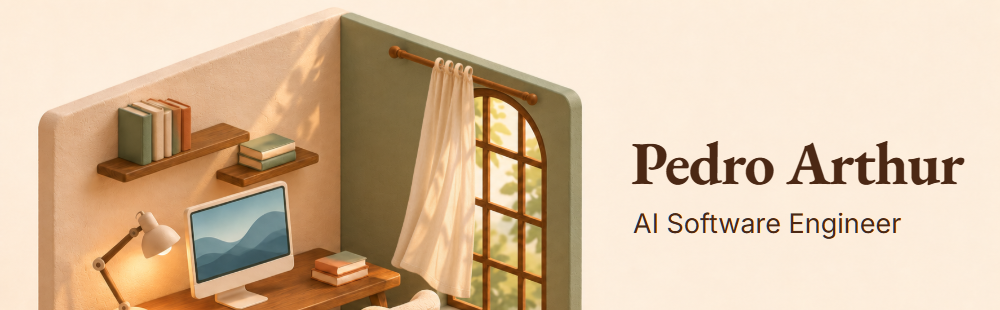

<picture><source media="(max-width: 600px)" srcset="../../assets/profile/scenes/estudio/header-mobile.png"></picture><a href="https://pdrarth.vercel.app/" aria-label="Portfólio"><picture><source media="(max-width: 600px)" srcset="../../assets/profile/scenes/estudio/portfolio-mobile.png"></picture></a><a href="https://www.linkedin.com/in/pdrarth/" aria-label="LinkedIn"><picture><source media="(max-width: 600px)" srcset="../../assets/profile/scenes/estudio/linkedin-mobile.png"></picture></a><a href="mailto:pedroarthurpdrarth@gmail.com" aria-label="Email"><picture><source media="(max-width: 600px)" srcset="../../assets/profile/scenes/estudio/email-mobile.png"></picture></a><picture><source media="(max-width: 600px)" srcset="../../assets/profile/scenes/estudio/footer-mobile.png"></picture>

